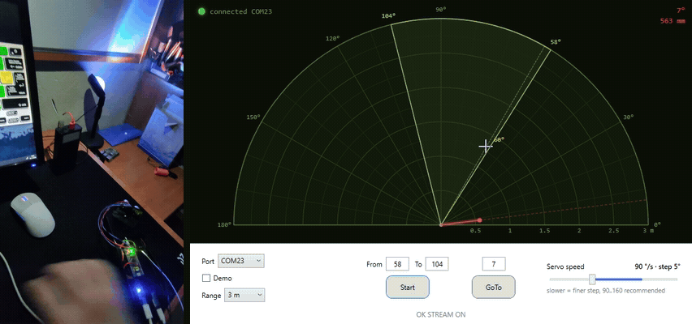
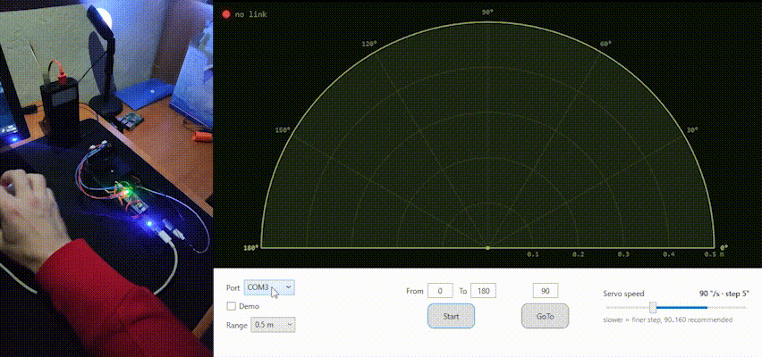
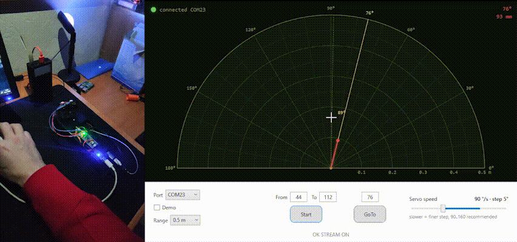

# Ultrasonic radar

**English** · [Українська](README.uk.md)

A DIY radar: an HC-SR04 ultrasonic sensor on a hobby servo sweeps a sector,
an STM32F103 (Blue Pill) measures the distance at every angle, and a WPF app
on the PC draws it as a radar screen in real time.



## Highlights

- **Bare-metal STM32 firmware** in C on top of HAL, with a non-blocking main loop.
  TIM2, TIM4 and USART1 are set up directly through registers.
- **Echo timing done in hardware**: TIM4 input capture times the HC-SR04 pulse
  with 1 µs resolution, with no interrupts and no dependency on main loop timing.
- **Step-and-measure scanner**: every distance belongs to a known servo angle.
  Servo speed and grid step can be changed at runtime.
- **Plain-text command protocol** over UART (`SCAN`, `GOTO`, `HOLD`, `SPEED`,
  `STEP`, `GET`, `STREAM`). You can drive the radar from any serial terminal.
- **WPF radar display** (C#, .NET Framework 4.7.2) with a built-in simulator,
  so the app works without hardware.
- **Hardware**: KiCad schematic and SolidWorks enclosure in the repo.

## How it works

### Firmware (STM32F103C8T6, 64 MHz)

```
 main loop (never blocks)
 ├─ Uart_ReadLine()  ← USART1 RX interrupt → ring buffer → command line
 ├─ Cmd_Process()    → parses the line, replies "OK ..." / "ERR ..."
 ├─ Scan_Update()    → scanner state machine, drives the ultrasonic driver
 └─ LED              → blinks; stays on when an object is closer than 200 mm
```

**Scanner state machine** ([scan.c](STM32F103C8Tx_Radar/Core/Src/scan.c)).
Each point goes through two states:

1. **MOVE**: command the servo to the next angle and wait until it settles,
   which takes 40 ms plus 2 ms per degree travelled. With a speed limit set,
   the servo is walked there degree by degree instead.
2. **MEASURE**: fire one ping and wait for the result, then store it in a
   0..180° distance table.

The mode then decides the next angle. `SWEEP` bounces between the sector
edges, `GOTO` travels one way to a target while measuring and then holds,
and `HOLD` keeps measuring a single angle. With the default 9° step and no
speed limit, one point takes 70 ms (14.3 Hz) and a full 0..180° sweep takes
about 1.4 s.

**Ultrasonic driver** ([ultrasonic.c](STM32F103C8Tx_Radar/Core/Src/ultrasonic.c)).
TIM4 runs freely at 1 MHz. Both capture channels listen to the same ECHO pin
(PB6). CH1 latches the rising edge and CH2 the falling edge, through a digital
input filter, so the pulse width is simply `CCR2 − CCR1`. The main loop only
polls the capture flags. Pings are at least 70 ms apart (the datasheet asks
for ≥ 60 ms), and if no echo arrives within 50 ms the point counts as empty.

**Servo** ([servo.c](STM32F103C8Tx_Radar/Core/Src/servo.c)).
TIM2 CH1 generates 50 Hz PWM on PA0, with 500–2500 µs mapped to 0–180°.

**Clock.** The 8 MHz crystal on this Blue Pill does not start, so the MCU runs
from the internal HSI oscillator through the PLL at 64 MHz.

### Command protocol

USART1, 115200 8N1, one command per line, case-insensitive.
The parser in [cmd.c](STM32F103C8Tx_Radar/Core/Src/cmd.c) does not depend on
the transport: it takes a line and a write function.

| Command | What it does |
|---|---|
| `SCAN 40 70` | sweep the sector 40..70° back and forth |
| `GOTO 120` | move to 120°, measuring on the way, then keep measuring there |
| `HOLD 120` | turn straight to 120° and keep measuring that angle |
| `SPEED 90` | servo speed limit, deg/s (`0` = no limit) |
| `STEP 5` | angle between measurement points, 1..30° |
| `STOP` | stop, the servo holds its angle |
| `GET` | dump the sector: `DATA 40:523 49:518 ...` (angle:mm) |
| `STREAM ON` | push every new point as soon as it is measured: `P 45 523` |

The full reference, with timing tables, is in [setup.md](setup.md) (Ukrainian)
and in [cmd.h](STM32F103C8Tx_Radar/Core/Inc/cmd.h).

### PC app ([Radar/](Radar/))

- Talks to the board over a COM port and turns on `STREAM` mode. Every
  `P <angle> <mm>` line moves the beam on the radar screen.
- The board may have been reset at any moment, so the app re-sends `SPEED`
  and `STEP` with every command.
- The grid step follows the servo speed: step = the angle the servo turns in
  50 ms, clamped to 2..8°. That way, points arrive at about 10 Hz at any speed,
  and a slower servo gives a denser picture.
- A heartbeat drives the link lamp (red/green).
- A simulator (`Demo` checkbox) speaks the same protocol.
- The display scale changes with the mouse wheel or the keyboard volume knob.
  A low-level keyboard hook catches the knob, so the system volume stays unchanged.

## Quick start

1. **Connect the USB-UART adapter**: adapter TX → PA10, adapter RX → PA9, GND → GND.
2. **Power the board through the 5V pin** from a proper 5 V supply that also
   feeds the servo and the HC-SR04. **Do not power it through the Blue Pill's
   micro-USB port.** The servo's current peaks pull the 5 V rail down, and
   after about a minute the MCU resets. All grounds must be connected together.
3. **Pick the COM port** in the app: it's the one that appeared after you
   plugged in the adapter. The lamp turns green when the radar answers.
4. **Use the radar**:
   - Drag across the screen (or use From/To + Start) to scan a sector.
   - Click on it (or use GoTo) to look in one direction.
   - Change the scale with the mouse wheel or the volume knob.



No hardware at hand? Tick **Demo** and the app runs against the simulator.

### About the range

The HC-SR04 datasheet promises up to 4 m. My cheap clone tops out at
**~2 m**, so I keep the display scale at 2 m.



## Build

Prebuilt binaries are in [Releases](https://github.com/vovchik03/Ultrasonic-Radar/releases):
the firmware `.hex` (flash it with STM32CubeProgrammer and an ST-Link) and
the packed Windows app. To build from source:

- **Firmware**: a CMake project (STM32CubeMX-generated). Build it in VS Code
  with the `Build (Debug)` task, or open it in STM32CubeIDE, then flash it
  with an ST-Link over SWD (PA13 / PA14).
- **App**: open [Radar/Radar.slnx](Radar/Radar.slnx) in Visual Studio
  (.NET Framework 4.7.2).

## Repository layout

```
STM32F103C8Tx_Radar/   firmware (Core/Src: scan, ultrasonic, servo, uart, cmd)
Radar/                 WPF radar display + simulator
PCB/                   KiCad schematic
CAD/                   SolidWorks enclosure parts (+ STEP)
gif/                   demo recordings
setup.md               wiring, power, command reference, timing (Ukrainian)
```

## License

[MIT](LICENSE)
