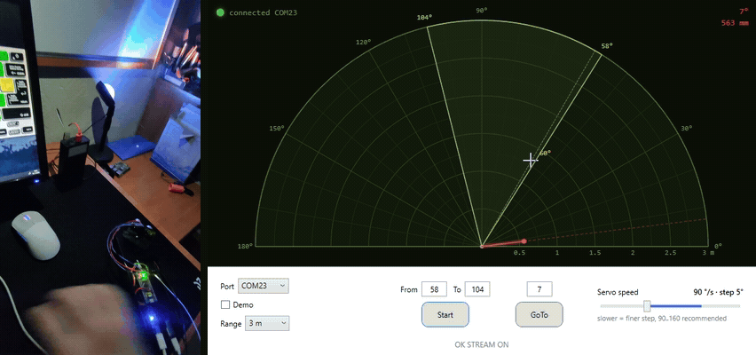
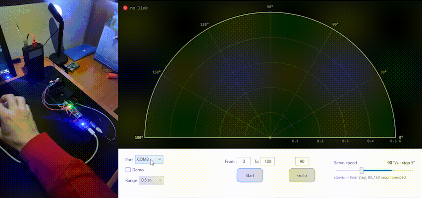
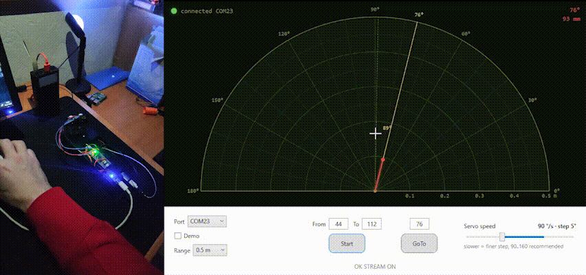

# Ultrasonic radar

[English](README.md) · **Українська**

Саморобний "радар": HC-SR04 на сервоприводі крутиться туди-сюди, STM32 (Blue Pill)
міряє відстань на кожному куті, а WPF-додаток на ПК малює все це як справжній
екран радара.

## Що всередині

- **Blue Pill** (STM32F103C8T6) — прошивка в [STM32F103C8Tx_Radar/](STM32F103C8Tx_Radar/)
- **HC-SR04** — ультразвуковий далекомір
- **Серво SG90 / MG90S** — крутить датчик на 0..180°
- **USB-UART адаптер** (CP2102 / CH340 / FT232) — зв'язок з ПК
- **WPF-додаток** для Windows — [Radar/](Radar/)
- Корпус у [CAD/](CAD/), схема в [PCB/](PCB/)

Повна розпіновка, команди прошивки і всі цифри по таймінгах — у [setup.md](setup.md).

## Як запустити

### 1. Спочатку USB через адаптер

Підключаємо USB-UART адаптер до ПК і до Blue Pill:
TX адаптера → PA10, RX адаптера → PA9, GND → GND.
Лінії перехрещуються, це нормально.

### 2. Потім живлення на Blue Pill

І тут є нюанс. **Не живіть плату через micro-USB роз'єм на самій Blue Pill.**
Серво під час руху тягне чималий струм, і десь за хвилину роботи плата
просто піде в ресет: 5 В просідає, і МК перезавантажується.

Тому живлення подаємо **на шину 5V** (пін 5V на Blue Pill) від нормального
джерела на 5 В, від якого живляться і серво, і HC-SR04. Усі GND мають бути
з'єднані між собою: плата, датчик, серво, адаптер і джерело.

### 3. Вибираємо COM-порт

Запускаємо додаток і відкриваємо список **Port**. Шукаємо порт, який з'явився
після підключення адаптера, тобто той, якого раніше не було. Це наш.
Можна відкрити список до і після підключення адаптера й порівняти.

Коли радар відповідає, лампочка вгорі зліва стає зеленою і показує
`connected COMx`.

> Немає заліза під рукою? Постав галочку **Demo**, і додаток підключиться
> до симулятора радара.

### 4. Крутимо радар

Після вибору порту можна вже працювати:

- **Сектор огляду**: впиши кути в **From** / **To** і натисни **Start**,
  або просто протягни мишкою по екрану радара. Серво ганятиме датчик
  туди-сюди в цьому секторі.
- **Конкретний напрямок**: впиши кут у поле над **GoTo** і натисни кнопку,
  або клікни по екрану радара. Серво доїде туди, міряючи дорогою,
  і далі дивитиметься лише в цей бік.
- **Масштаб**: колесико миші над радаром, колесико гучності на клавіатурі
  або список **Range**. Поки вікно активне, колесико гучності змінює масштаб,
  а не гучність системи.
- **Servo speed**: швидкість серво. Що повільніше, то густіша сітка точок.
  Найкраще 90..160 °/с.

## Про дальність

Даташит HC-SR04 обіцяє до 4 м. Моя китайська підробка чесно бачить максимум
**~2 м**, далі вже нічого не вертається. Тому на шкалі зручно тримати 2 м.
Якщо у вас оригінальний датчик, може пощастити більше.

## Збірка

Готові файли лежать у [Releases](https://github.com/vovchik03/Ultrasonic-Radar/releases):
`.hex` прошивки (шиється через STM32CubeProgrammer і ST-Link) і запакований
додаток для Windows. Якщо хочеш зібрати сам:

- **Прошивка**: CMake-проєкт, у VS Code збирається задачею `Build (Debug)`,
  а прошивається через ST-Link по SWD (PA13 / PA14). Можна відкрити і в STM32CubeIDE.
- **Додаток**: відкрити [Radar/Radar.slnx](Radar/Radar.slnx) у Visual Studio,
  потрібен .NET Framework 4.7.2.

## Ліцензія

[MIT](LICENSE)
